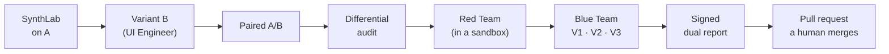

# Janus Arena

[](https://github.com/oblivionwing26/janus-arena/actions/workflows/ci.yml)
[](LICENSE)

**A pre-release gate that catches UX-friction regressions and security regressions in the same
pull request, and measures the UX cost of every security fix.**

Teams test usability and security separately. In production they happen at once, and they
interact: a rate limit, a CAPTCHA or an extra verification step closes a hole and quietly hurts
legitimate users. Janus measures that trade-off before release.

- **SynthLab** runs synthetic user personas through two variants of a web app in a real browser.
  A language model decides each next action; everything else (friction, success, latency,
  statistics) is computed by code.
- **WarRoom** audits a variant statically, attacks it in an isolated sandbox with a Red Team
  engine, patches what it finds with a Blue Team agent, and re-verifies both the security fix and
  its UX cost.
- **Output:** a signed dual report (UX A/B plus security) attached to a pull request that a human
  reviews. Janus never merges and never approves.

## Try it without keys, a backend or a model

**Live demo: <https://janus-arena.vercel.app>**

The console has a demo build that replays recorded runs in your browser: three real stories (11
runs, 5 MB of JSON) and nothing to start. To run the same build yourself:

```bash
pnpm install
pnpm demo:build
pnpm --filter @janus/web-console start   # http://127.0.0.1:3012
```

Start from the **attack graph** of the Juice Shop gate: the Red Team finds six vulnerabilities, the
Blue Team fixes the basket IDOR, and the endpoint goes red, then amber, then green as three
independent verifiers agree. (The console's labels are in Spanish; the demo's explanations are
in English.)

**Watch the 3-minute video: <https://youtu.be/rH7XLE4Ujks>**

## What it found, with the numbers

Every figure below comes from a signed report or a run in this repository, and the unflattering
ones are included.

| What                                             | Result                                                                                                                                                                                                                          |
| ------------------------------------------------ | ------------------------------------------------------------------------------------------------------------------------------------------------------------------------------------------------------------------------------- |
| UX A/B on ShopLab, a generated variant B         | Synthetic task success B − A: **+50 points**, 95 % interval [17, 83], 6 pairs ([report](docs/reports/dual-shoplab/dual-report.md))                                                                                              |
| The full gate on ShopLab                         | B − A **+83 points**, interval [50, 100]; the differential audit finds nothing B introduces ([report](docs/reports/gate-01M796CT3J5XRRXAREPJ88M525/dual-report.md))                                                             |
| The full gate on OWASP Juice Shop                | Six vulnerabilities confirmed, each with a PoC replayed by code; the basket IDOR fixed with all three verifiers passing ([report](docs/reports/gate-01M79YYR766FTNCYF5STGZ3ANY/dual-report.md))                                 |
| A fix that costs UX, and a better alternative    | An account lockout stops brute force but locks out a forgetful persona (success 4/6 → 3/6); a per-account rate limit stops it with 4/6 → 5/6 ([trade-off report](docs/reports/tradeoff-01M786YYJN2NDQHVQT1HGGNY93.md))          |
| Red Team recall on Juice Shop (public benchmark) | **6 of 60** challenges in the categories where it acts (10.0 %, Wilson 95 % [4.7 %, 20.1 %]), 5 of 5 on the challenges it was built around; 5 of 60 without one side effect ([benchmark](docs/reports/benchmark-juice-shop.md)) |

The benchmark is low on purpose: the Red Team's engine only generates the attacks it was
programmed for (ADR 0011), and the report says so.

## How it works



`pnpm run:gate` runs this pipeline, one stage at a time, recording each stage in its own event log.
Kill it at any point and resume it: completed stages are not played again (ADR 0016).

**Deterministic first, LLM second.** Code computes friction signals, statistics, static analysis,
attack success (oracles), PoC execution, budgets, hashes and signatures. The model only decides the
next browser action, proposes patches and writes prose. An attack succeeds only when a
deterministic oracle says so, and attacks themselves are generated by code, never by a model
(ADR 0011).

**The patch is verified three ways.** A fix is accepted only if (1) the original PoC no longer
works, (2) the target's tests plus a regression test derived from the PoC pass, and (3) a SynthLab
re-run stays within the success-rate and latency tolerances.

**One append-only event log is the source of truth.** A database trigger rejects updates and
deletes. Any run replays without a model or a key, and the live view and the replay share one
rendering code (ADR 0003).

```
apps/
  orchestrator-api/   NestJS on Fastify, hexagonal: domain → application → infrastructure → interface
  web-console/        Next.js: runs, timeline, replay, swarm canvas, attack graph, demo build
packages/
  shared-kernel/      event envelope and zod schemas
  friction-engine/    pure: events → friction signals
  stats/              pure, seeded: Wilson, paired bootstrap, A/B summary
  synthlab-report/    pure: events → report (zones, funnel, cost)
  observation-builder/ page → pruned accessibility tree for the agent
config/               models by role, funnels, scopes, surface, benchmark, demo
gates/                one file per target: run file, budget by stage, options
docs/                 VISION, ROADMAP, ADRs, FinOps, reports, articles
```

The architecture rules (the domain imports nothing but the shared kernel, and so on) are enforced
in CI by `pnpm check:arch`.

## Run it yourself

You need Node 24 (`.nvmrc`), pnpm, and Docker.

```bash
pnpm install
cp .env.example .env            # local credentials for the Docker services
docker compose up -d            # Postgres, Redis, the Docker socket proxy, the agent browser
pnpm db:migrate
pnpm dev                        # orchestrator on :3011, console on :3012
```

Everything that does not call a model needs no key:

```bash
pnpm lint && pnpm typecheck && pnpm test && pnpm check:arch   # the CI checks
pnpm test:poc                      # replay the saved PoCs on a fresh Juice Shop sandbox
pnpm run:replay <runId|file>       # replay a run from the database or an exported file
pnpm run:red-team juice-shop       # the Red Team engine: deterministic, no model
pnpm run:benchmark juice-shop      # the public benchmark: a control and 3 fresh rounds
pnpm janus verify <report-dir>     # check a signed report: signature, attestation, event-log hashes
```

Runs that use a model need `ANTHROPIC_API_KEY` in `.env`, and every run declares a budget that the
gateway enforces:

```bash
pnpm run:gate gates/shoplab.yaml       # the whole gate on ShopLab (needs pnpm dev)
pnpm run:gate gates/juice-shop.yaml    # the whole gate on Juice Shop
pnpm run:blue-team <poc.json>          # fix one finding, verified by V1, V2 and V3
```

Opening a pull request is optional and uses a GitHub App you create yourself
(`JANUS_GITHUB_APP_ID`, `JANUS_GITHUB_APP_KEY`, `JANUS_GITHUB_INSTALLATION_ID`; see ADR 0015).
`pnpm demo:export` rebuilds the demo's runs from your own event log.

The demo target app, ShopLab, lives in a separate repository (`janus-shoplab`) and is cloned into
`.workspaces/` when a run needs it. The security target is OWASP Juice Shop, pinned by digest.

## What Janus does not claim

- Synthetic users do not predict real revenue or conversion. Reports speak of **synthetic task
  success** with confidence intervals, never of "conversion lift", and a result whose interval
  crosses zero is reported as "no detectable difference".
- AI pentesting is not fully autonomous here: findings need a reproducible PoC, and patches need
  human review.
- Janus is not a replacement for real user research or for a professional penetration test.

## Responsible use

Janus includes offensive modules. They start only with a verified scope (the target proves
ownership with a token), every request passes through a guard, targets run in a network with no
internet access, and agents get no arbitrary code execution. Use it only on systems you own or are
authorised to test. See [SECURITY.md](SECURITY.md).

## Read more

- [docs/VISION.md](docs/VISION.md): what it is, what it is not, and the principles.
- [docs/adr/](docs/adr): the architecture decisions, from the hexagonal layout to how the benchmark is scored.
- [docs/ROADMAP.md](docs/ROADMAP.md): the step-by-step plan, in Spanish, with how each step was verified.
- [docs/finops.md](docs/finops.md): what a session really costs.
- [What synthetic users measure, and what they don't](https://dev.to/oblivionwing26/janus-arena-development-1ce): the article on the SynthLab half, on dev.to ([the same text](docs/articles/what-synthetic-users-measure.md) is in the repo).
- [The UX cost of a security patch](docs/articles/ux-cost-of-a-security-patch.md) and [Our benchmark on Juice Shop, without makeup](docs/articles/benchmark-without-makeup.md): the Red/Blue half and Launch Day, drafts in the repo.
- [docs/articles/](docs/articles): write-ups of what the runs showed.
- [`@oblivionwing26/friction-engine`](packages/friction-engine/README.md): the friction detectors as an npm package (pure functions, no browser, no model).

## License

[MIT](LICENSE)
